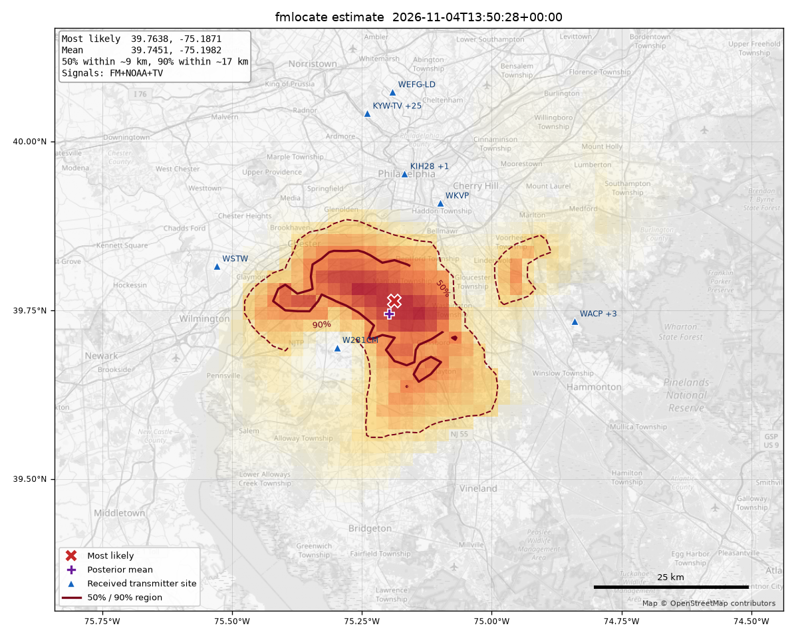

# fmlocate

Estimates where you are **without GPS, Wi-Fi or a location service**. It uses which
FM radio, digital TV and NOAA Weather Radio stations an attached software-defined radio
receives, and how strongly, and compares that with the FCC and NOAA transmitter
databases. It prints an estimate with its uncertainty and writes a heatmap PNG.

Expect accuracy in **kilometres to tens of kilometres**, not metres. The
[results](#results-on-real-data) section says how well it actually did.



## Install

Python 3.9+ on macOS or Linux, and one of these for the radio:

| Radio | Install |
|---|---|
| RTL-SDR dongles | rtl-sdr tools. macOS: `brew install librtlsdr`. Debian/Ubuntu: `sudo apt install rtl-sdr` |
| HackRF, Airspy, SDRplay, LimeSDR, PlutoSDR, USRP, RTL-SDR, ... | [SoapySDR](https://github.com/pothosware/SoapySDR) with its Python bindings and the module for your radio. macOS: `brew install soapysdr soapyhackrf` (etc.). Debian/Ubuntu: `sudo apt install python3-soapysdr soapysdr-module-all` |

```bash
pipx install git+https://github.com/jonathanmaxberman/fmlocate
# or: pip install git+https://github.com/jonathanmaxberman/fmlocate
```

SoapySDR's Python module isn't on PyPI. It comes with the system or Homebrew Python, so
for the Soapy backend install fmlocate into that Python, or into a venv made with
`--system-site-packages`.

**What's been tested.** Both backends were run on the same RTL-SDR (Nooelec NESDR SMArt v5)
under macOS 26.1, minutes apart:

| | rtl backend | Soapy backend (Homebrew SoapySDR 0.9 + SoapyRTLSDR 0.3.4) |
|---|---|---|
| FM channels received / RDS | 15 / WVCW decoded | 13 / none decoded in the full run (WVCW decoded in a separate test) |
| TV channels with a reading | 20 | 20; levels agree within about 2 dB, pilots within about 3 dB |
| Error of the full estimate | 10.9 km, inside the 90% region | 26.4 km, just outside it |

The two backends measure the same thing. The difference in the estimates is the run-to-run
spread of the method in one indoor spot: TV-only replays of the two runs put the posterior
mean 11.2 and 11.7 km away, but put the single most likely cell 4.5 and 39.7 km away. Other
Soapy radios (HackRF, Airspy, ...) haven't been tried. Notes:

- The Soapy backend sweeps in Python. A 140 MHz UHF sweep takes about 10 s, against about 7 s
  for `rtl_power`.
- After each retune it discards the driver's in-flight transfers. SoapyRTLSDR's default
  transfers are ~55 ms each, and without this the next frequency's spectrum contains the last
  one's signals. For RTL-SDRs it asks for small transfers (`bufflen=16384`).
- conda-forge's SoapyRTLSDR/librtlsdr build delivered no samples on the test Mac and left the
  dongle wedged until it was replugged. Homebrew's build works.
- On macOS 26.1, Homebrew's Python 3.15 (which `brew install soapysdr` builds the bindings
  for) returns an empty `platform.mac_ver()`, and pip 26.2 fails with
  `invalid literal for int()`. One workaround is to install fmlocate's dependencies into a
  Python 3.15 venv using another Python's pip:
  `pip install --target VENV/lib/python3.15/site-packages --python-version 3.15 --only-binary=:all: numpy scipy matplotlib`.

## Use

```bash
fmlocate                      # measure (about 5 minutes), estimate, write fmlocate-<time>.png
fmlocate --list-sdrs          # what radios it can see
fmlocate --sdr soapy:driver=hackrf --gain 30
fmlocate --no-png --json result.json
```

Output looks like this (the true location of this example is withheld):

```
Estimate:        39.7638, -75.1871   (most likely grid cell)
Posterior mean:  39.7451, -75.1982
Uncertainty:     50% within ~9 km, 90% within ~17 km (area-equivalent radii)
1-sigma ellipse: 11 x 8 km, long axis bearing 100 deg
...
channel level   S/N obs  pred   station (dominant licence at estimate)          dist
  -- FM
   93.7  10.8   10.4   -1.5   12x  WSTW        47.10 kW  153 m  Wilmington, DE        30 km
  ...
```

Each run saves its raw measurement (spectra, RDS results) to
`~/Library/Application Support/fmlocate/measurements/` on macOS, or
`~/.local/share/fmlocate/measurements/` on Linux, so it can be re-estimated later
with `--replay`.

Main options:

| Option | What it does |
|---|---|
| `--sdr auto\|rtl[:INDEX]\|soapy[:ARGS]` | Receiver backend (default: rtl-sdr tools if they find a dongle, else the first SoapySDR device) |
| `--gain DB`, `--ppm N` | Tuner gain (rtl default 40.2 dB; Soapy default 80% of the device's range) and frequency correction |
| `--signals fm,tv,wx` | Which signals to measure and use (`wx` = NOAA Weather Radio). FM is always swept, because RDS sets the search centre |
| `--png FILE`, `--no-png`, `--no-basemap` | Heatmap image. By default it's written with an OpenStreetMap background, which falls back to a plain lat/lon grid when offline |
| `--map FILE.html` | Also write an interactive Leaflet map |
| `--json FILE` | Result as JSON |
| `--replay FILE` | Re-estimate from a saved measurement |
| `--prior auto\|rds\|ip\|LAT,LON`, `--radius KM`, `--step KM` | Search centre and grid. The default centre is the RDS-identified transmitters, else a coarse IP guess |
| `--truth LAT,LON` | Report the error against a known location |
| `--offline`, `--cache-dir DIR` | Use only cached FCC/NOAA data and tiles |
| `--simple`, `--sigma-model DB` | Model options (see Method) |

The FCC and NOAA transmitter lists and map tiles are downloaded on first use and cached
in `~/Library/Caches/fmlocate` (macOS) or `~/.cache/fmlocate` (Linux). After that, the
location estimate itself needs no network.

Try it without a radio using a real measurement and its cached licence data:

```bash
git clone https://github.com/jonathanmaxberman/fmlocate && cd fmlocate
fmlocate --replay examples/measurements/example-2026-11-04-fm-tv-wx.json \
    --cache-dir examples/cache --offline --png example.png
```

**Sharing the tuner with RadioShelf.** If RadioShelf (a local radio recorder) is running on
`localhost:8765`, fmlocate won't start while it's recording, scanning, or due to record
within 15 minutes. Set `FMLOCATE_RADIOSHELF_URL` to change the address. Otherwise this check
does nothing.

## Method

1. **Measure.** It runs six 10-second sweeps from 87.5 to 108.3 MHz, about
   5 kHz bins with hop edges cropped (`rtl_power -c 0.3`, or the same thing done in Python
   for SoapySDR radios), and averages them in power. Each 200 kHz
   channel's level is the mean dB within ±60 kHz of the carrier, minus a local floor (see
   "Things learned" below for why it isn't a band-wide median). For up to 14 channels at least 3 dB above the floor (skipping
   ones that are just splatter from a channel 10 dB stronger next door), it captures
   8 s of FM multiplex and decodes RDS. The PI code gives the call sign (for US
   stations whose PI follows the call-letter formula).
2. **Licences.** One FCC `fmq` query returns every licensed FM transmitter (full
   service, translators, LPFM, boosters) within *search radius + 150 km* of the prior
   centre, with site coordinates, ERP and HAAT. Responses are cached in
   the cache directory. On an RDS-identified channel only that station (or, failing
   that, translators relaying it) is modelled. On an unidentified channel **every**
   licence on the frequency contributes, as a power sum.
3. **Propagation model.** Field strength is
   `E(dBµV/m) = 89.8 + 10·log P_kW + 13.0·log HAAT_m − 43.9·log d_km`. This is a
   least-squares fit to the six FCC class reference points of 47 CFR 73.211, for
   example Class A at 6 kW and 100 m reaching 60 dBµ at 28 km, and Class C at 100 kW and
   600 m reaching 60 dBµ at 92 km. These come from the F(50,50) curves, and the fit is
   within 0.5 dB at all six. The field is capped at free space. Beyond the radio horizon
   it loses an extra 0.15 dB/km, which is a guess. Directional antenna patterns are
   ignored.
4. **Receiver.** It predicts each channel's S/N as `E + c`. Here `c` is one unknown
   offset shared by every channel: antenna gain, average building loss, noise figure
   and bin bandwidth. The posterior integrates over `c` with a flat prior from −140 to +20 dB.
   So only the *differences* between stations, and the absence of stations, carry
   location information. A measured level `L` above the floor converts to
   S/N = 10·log(10^(L/10) − 1).
5. **Likelihood.** Received channels (L ≥ 2 dB) are Gaussian in S/N, with
   σ = √(2² + 8²) ≈ 8.2 dB. That covers 2 dB of measurement noise and 8 dB of propagation
   and building error. Channels below 2 dB are **censored**: the likelihood is
   P(predicted S/N + error < threshold). This is how "a 50 kW station 20 km
   away should be booming here but isn't" counts against a position. Each channel has a
   3% outlier probability (off air, blocked, a spur or intermod) so one bad channel
   can't veto a location.
6. **Search.** It evaluates every point on a grid with 2 km spacing, ±150 km around the prior
   centre. By default the centre is the centroid of the RDS-identified transmitters.
   With no RDS, it falls back to IP geolocation, labelled as such in the output, or to
   `--prior LAT,LON`. The position prior is flat over the grid, so the centre only
   decides *where to look*. If more than 5% of the probability sits at the grid edge,
   the output warns.
7. **Output.** It reports the most likely grid cell and the posterior mean. It gives
   area-equivalent 50% and 90% radii (the smallest set of cells holding that
   probability, expressed as a circle radius) and a 1-σ ellipse from the posterior
   covariance. It lists each channel with its observed and predicted S/N, and the
   dominant licence and distance at the estimate. `--map` writes a Leaflet page
   (cdnjs, OpenStreetMap tiles) with the probability heatmap, the transmitters, the
   estimate and its 90% circle, and the known location if given.

### TV and NOAA Weather Radio

The dongle tunes 24–1766 MHz, so it also covers every US TV channel. Those are 2–6 (54–88 MHz),
7–13 (174–216 MHz) and 14–36 (470–608 MHz, after the 600 MHz repack). It also covers the seven
NOAA Weather Radio channels at 162.400–162.550 MHz.

- **TV licences.** The FCC `tvq` query returns the same column layout as `fmq`. Full-power,
  Class A, low-power, DTS sites and digital translators are included (licensed or STA).
  Several licences sharing one transmitter (channel sharing, or a DTS site that repeats the
  main record) are one signal, so they are merged per channel and site.
- **NOAA licences.** NWS's `ccl-data.js` (the data behind its station pages) lists all
  ~1,000 transmitters with coordinates and power, cached. Antenna
  height isn't published, so 150 m is assumed. Power is transmitter output, used as ERP.
- **TV measurement.** Each band gets four 5 s sweeps (≈5 kHz bins, cropped).
  A TV channel is 6 MHz wide and the dongle sees ~2.4 MHz at a time, so nothing is decoded and
  stations aren't identified. Like an unidentified FM channel, every licence on the channel
  counts. Two measures give each channel's S/N:
  - **ATSC pilot.** ATSC 1.0 carries a steady tone 309 kHz above the channel edge, 11.3 dB
    below the total power. In a 5 kHz bin it stands ~19 dB above the data. Its excess over the
    in-channel bins (summed over 3 bins, after finding rtl_power's ~1-bin label offset)
    detects stations down to about −17 dB S/N with no knowledge of the noise floor. It
    saturates near 0 dB S/N, so it's only used up to a 14 dB excess.
  - **Channel power.** Mean power over the channel's centre 5 MHz, against the band's floor
    (25th percentile of channel means). It's used once it's 6 dB or more above the floor, and
    it's the only measure for ATSC 3.0 stations, which have no pilot. In the office, channel 33
    (WPSG) is 21 dB up with no pilot, which is presumably ATSC 3.0. On VHF, a channel with power
    but no pilot is skipped: man-made noise near the computer produces exactly that.
  - Censored TV channels (no pilot, no power) mean "predicted S/N below −17 dB".
- **NOAA measurement.** Two 10 s sweeps at ≈0.8 kHz bins. Each channel's level is the mean
  within ±7 kHz over the span's 20th percentile, treated like an FM level.
- **Separate offsets per band.** FM, NOAA, VHF-low, VHF-high and UHF each get their own
  receiver offset `c`, integrated out independently. Antenna gain, building loss, noise and
  measurement bandwidth all differ between them. So TV adds information through the *pattern*
  across its own channels and through missing stations, not by comparison with FM. The FM slope
  term applies only to FM. The building-loss-by-bearing term is shared by all bands.
- **Same propagation model.** FM's fit to the FCC F(50,50) points is reused for TV and NOAA.
  Field strength in dBµV/m is roughly frequency-independent at these distances, but the
  FCC's UHF curves lose a few dB more beyond about 50 km. That's not modelled, and it's part
  of what σ = 8 dB has to cover. ATSC 3.0 stations can't be told apart in the FCC data, so a
  weak one counts as a missed station, which the 3% outlier term absorbs.

### Receiver-response terms (default; `--simple` turns them off)

Two more nuisance terms are integrated out alongside `c`, on coarse grids with flat priors:

- **A slope across the band** of −8 to +8 dB per 10 MHz. The short whip and the building
  respond differently at 88 and 108 MHz. In the office, co-sited Philadelphia stations
  with similar ERP were received 5–10 dB apart, the higher frequencies stronger.
- **A cosine-shaped building loss by bearing.** It ranges from 0 to 24 dB, with the
  lowest-loss direction in one of 8 compass directions. Bearing is measured to each
  channel's dominant transmitter. In a windowless office, nothing came from the south or
  east, although several transmitters are close in those directions.

Together that's 125 receiver-response hypotheses × 51 offsets per grid cell. To keep the run
time near 1–2 minutes, a pass on a 6 km grid finds the plausible region first. Only that region
is then evaluated at 2 km. `--simple` takes about 2 s.

## Results on real data

### FM + TV + NOAA (4 November 2026)

These come from one live run indoors, in an office with an RTL-SDR and its telescoping antenna. No RDS was
decoded, so the search centre was the IP guess. The run received 14 of 101 FM channels, 22 of 33 TV
channels and 1 of 7 NOAA channels. The table shows replays of that one measurement
(`examples/measurements/example-2026-11-04-fm-tv-wx.json`) with different `--signals`. "Error" is
the distance from the true location (not published) to the most likely cell, with the
posterior mean's distance in brackets.

| Signals | Error (posterior mean) | 90% radius | Truth inside? |
|---|---|---|---|
| FM only | 14.2 km (16.7) | 27 km | yes |
| FM + NOAA | 14.2 km (13.2) | 23 km | yes |
| TV only | 10.9 km (13.0) | 29 km | yes |
| **FM + TV** | **9.3 km (8.5)** | **17 km** | yes |
| FM + TV + NOAA (default) | 9.3 km (8.8) | 17 km | yes |
| FM + TV + NOAA, `--simple` | 10.8 km (11.1) | 8 km | **no** |

- **TV on its own is about as good as FM, and the two together are better than either.**
  The 90% radius shrinks from 27 to 17 km and the posterior mean moves from 17 to 8 km.
  UHF gave the most: 17 of 23 channels received, and the strong Philadelphia stations
  predicted within a few dB.
- **NOAA adds little here.** Only Philadelphia's KIH28 is received.
- **Again, `--simple` is overconfident.** It claims ±8 km and misses.
- **VHF is poor in this room.** Channel 13 (WHYY-TV, 30 kW, 30 km) is barely seen, and
  channels 5, 11 and 12 show noise without a pilot. The telescoping antenna and local
  interference are the likely causes.
- This is still one room and one run. The real test is other locations.

### FM only (2 November 2026)

These are three sweeps from the same office on 2 November 2026, about 35 minutes apart,
using FM only.

| Sweep | Search centre | Full model | `--simple` |
|---|---|---|---|
| 18:03 UTC, uncropped rtl_power (hop-edge artefacts) | WVCW site (RDS) | **20 km** (23); truth inside the 90% region (r ≈ 24 km) | 19 km (25); truth **outside** the 90% region (r ≈ 13 km) |
| 18:13 UTC | IP guess (no RDS decoded) | **42 km** (29); inside (r ≈ 24 km) | 41 km (32); **outside** (r ≈ 13 km) |
| 18:38 UTC | WVCW site (RDS) | **17 km** (20); inside (r ≈ 25 km) | 18 km (25); **outside** (r ≈ 14 km) |

For comparison:
- IP geolocation (ipinfo.io) was about **15 km** from the truth.
- Simply taking the strongest RDS transmitter (WVCW) as the answer would be 38 km off.

What this means:

- **With FM only, accuracy here is about 15–45 km.** That's no better than IP geolocation. The estimates are
  pulled 15–40 km north-west of the truth, towards the cluster of stations the office
  receives (Philadelphia's Roxborough tower farm and Wilmington). The south-eastern
  transmitters are much closer to the true location, and the building blocks them.
  With only these measurements, the model can't fully tell "the building blocks the south-east" apart
  from "the receiver is far from the south-east".
- **The uncertainty is honest only with the receiver-response terms.** The `--simple`
  model claims ±13 km and misses the truth every time. The full model widens to a ±24 km
  90% radius and contains the truth in all three sweeps. That's three sweeps from one
  room, so it's anecdote, not calibration.
- **Expect better results with a better antenna position.** A window, outdoors or a car
  would give more stations, more RDS decodes, and less direction-dependent loss. The
  method is the same idea as the FCC's own coverage maps run backwards. It can't do
  better than the ±8 dB those curves carry for a single location, which at these
  distances is roughly ±20–40% of the range to each transmitter.

### Things learned about the measurement

- **rtl_power's hop edges matter.** Without `-c` (crop), the floor has 5–8 dB steps at
  each 2.6 MHz hop. Channels near a hop boundary read up to 8 dB low (99.5 read
  4.4 dB in one sweep and 12.6 dB in the next). FMLocate sweeps with `-c 0.3`. It
  measures each channel against a local floor (the 20th percentile of the bins within
  ±1.5 MHz), then subtracts the median channel level, since most channels are empty.
  Six 10 s sweeps agree to about 0.1 dB.
- **RDS decodes are intermittent.** WVCW and WSTW decode on some runs and not on
  others, so the search centre falls back to IP geolocation (labelled as such). The
  position prior is flat within ±150 km, so the centre only decides where to look.
- **104.1 MHz ("MAXIMA", PI D166)** is one of the strongest signals. Yet no licence in the
  FCC data fits it at the true location (the nearest 104.1 translators are 0.04–0.25 kW
  at 16–20 km). The model treats it as an outlier. It might be an unlisted or newly
  licensed translator.
- **RadioShelf contention.** Every `GET /api/status` makes RadioShelf run `rtl_test`
  for up to 6 s, if its device cache is more than 60 s old, which briefly takes the dongle.
  FMLocate waits 7 s after its status check, and retries sweeps and captures that come back empty.

## Files

- `fmlocate/__main__.py`: command line and printed report.
- `fmlocate/sdr.py`: receiver backends (rtl-sdr tools, SoapySDR) and FM demodulation.
- `fmlocate/measure.py`: RadioShelf check, sweeps, FM channel levels, RDS probes, TV pilot/power
  levels and NOAA levels.
- `fmlocate/rds.py`: RDS/RBDS decoder and PI-to-call-sign.
- `fmlocate/fcc.py`: FCC `fmq` and `tvq` queries, with ERP, HAAT and facility parsing, and a cache.
- `fmlocate/noaa.py`: NOAA Weather Radio transmitter list, cached.
- `fmlocate/solve.py`: propagation model, likelihood, grid search and posterior summary.
- `fmlocate/plot.py`: the heatmap PNG. `fmlocate/mapview.py`: the Leaflet map.
- `examples/measurements/*.json`: the real sweeps behind the results below (the 2026-11-04 one
  includes TV and NOAA spectra). Each holds per-channel levels, RDS results, the averaged
  spectrum (so levels can be recomputed) and per-sweep levels. The IP guess is rounded to
  0.1°, and the true location is left out.
- `examples/cache/`: cached FCC and NOAA responses, so the examples replay with `--offline`.

Replays recompute channel levels from the saved spectrum with the current definition. The
18:03 file comes from before cropping was added, so it still carries the hop-edge
artefacts.

## Limitations and ideas

- Directional transmit antennas, terrain (the F(50,50) curves assume average terrain)
  and the over-horizon term are not modelled, or only crudely.
- The censoring threshold (2 dB above the empty-channel median) and σ = 8 dB were set by
  hand on this same data. There is no held-out test.
- Several runs at different times, or a second location as a reference, would separate
  building effects from distance far better than one room can.
- Stereo pilot level and RDS block error rate could act as extra, gain-independent signal-quality features.
- TV ideas not yet tried: co-channel ATSC stations are often offset by a few kHz (FCC
  precise-offset rules), so the pilot's exact frequency could tell which licence is received.
  An antenna cut for UHF (≈14 cm per arm) and VHF-high (≈37 cm per arm) would help those bands.
